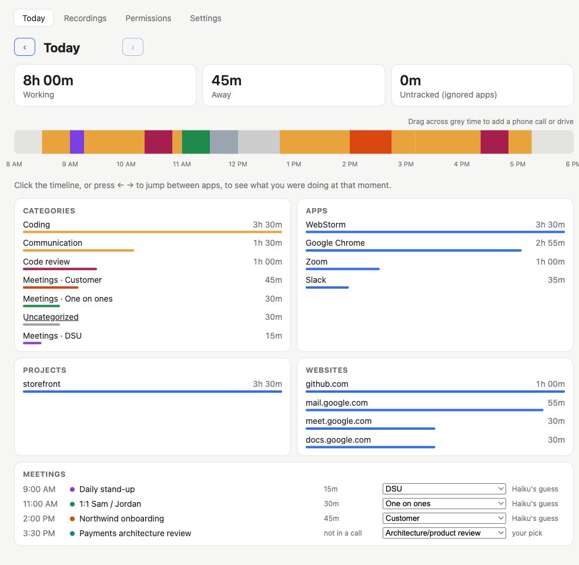
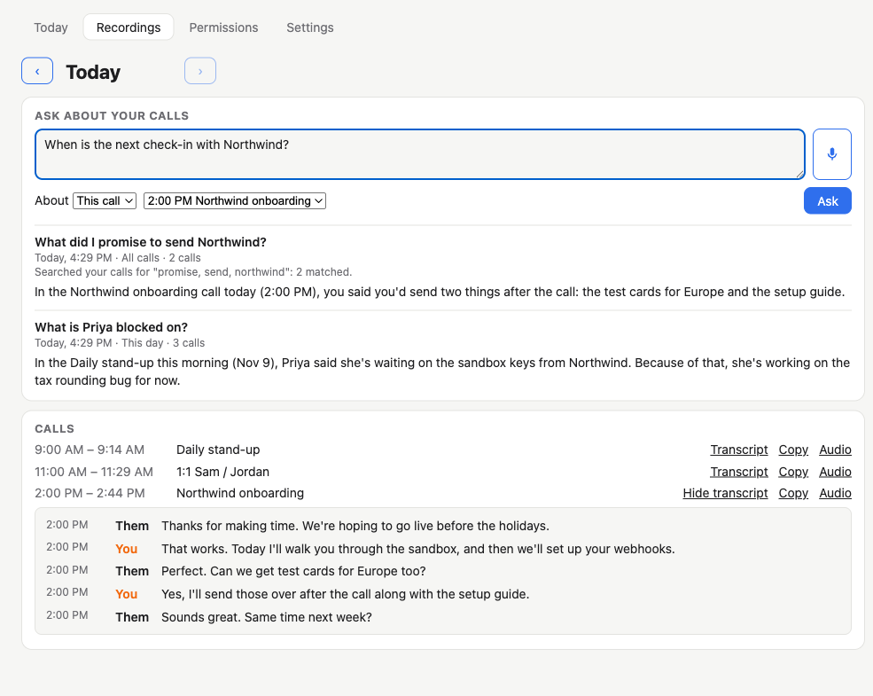

# Time Center

A Mac menu-bar app that shows where your day went. It joins your meetings on time, then records and
transcribes your calls.

Everything stays on your Mac: the activity log, screenshots, recordings and transcripts. Nothing leaves
it except five things, and only when you set them up or use them: a weekly backup of the database to
your own S3 bucket, meeting titles sent to Claude to sort them into types, the transcripts of the calls
you ask Claude a question about, the transcript of a call you're watching live on the Recordings tab,
which Claude reads for action items, and a TODO you choose to make into a Jira ticket.





<sub>Screenshots use a made-up day.</sub>

## What it does

- **Today tab.** A timeline of the day, with each stretch of time labelled by app, website or window and
  sorted into categories such as "Code review" or "Email". Click any stretch to see the screenshot taken
  then. To add time the Mac couldn't see, such as a call on your phone or a drive, drag across the timeline.
- **Joins meetings.** It reads your Google Calendar and opens each meeting 30 seconds before it starts.
  Zoom meetings open in the Zoom app; Google Meet and Teams open in Chrome, where you click Join. If you'd
  rather not have meetings opened for you, set **Settings → Meetings → When a meeting starts** to "Just
  notify me" (a notice you click to join) or "Do nothing".
- **Records calls.** Whenever another app is using the microphone (Zoom, Meet, Teams, Slack…), the call is
  recorded, and a red dot shows
  on the menu-bar icon. Each call becomes one file, such as `2026-11-09 Weekly sync.m4a`.
- **Transcribes calls on your Mac.** Transcription uses [whisper.cpp](https://github.com/ggml-org/whisper.cpp)
  at low priority, and nothing is uploaded.
- **Recordings tab.** Your calls for the day, each with its transcript, a Copy button and a link to the
  audio file. Moving to a call in another app (Zoom, then Meet in Chrome, then Teams) starts a new recording
  once the new app has had the microphone for 20 seconds. One call that runs through several calendar meetings
  is named after each of them, with a heading in the transcript where each starts. Which meeting you were in
  comes from the calendar and the window in front: a Meet tab or Teams window that names the meeting wins. Zoom's
  windows don't name the meeting, so for Zoom the calendar decides, and an accepted meeting comes before a
  "maybe" that overlaps it. Pick a day in either the Today tab or the Recordings tab, and the other tab shows the same day.
- **Action items during a call.** While a call is going, the Recordings tab shows its transcript on the
  left as it's heard and, on the right, the five newest possible action items ("You: send Dana the test
  cards"), found by Claude Haiku. Haiku only reads the call while that tab is open and the window is in
  view, at most once a minute, plus a last look in the few minutes after the call ends while its final
  words are transcribed. The items stay with the call, under it in the list of earlier calls.
- **Ask about your calls.** At the top of the Recordings tab, type a question, or click the mic to say
  it (whisper turns it into text on your Mac). Ask about one call (even one still going), the picked
  day's calls, or all your calls. For all calls, the app searches the transcripts for your question's
  words and sends only the calls that match. Claude Sonnet answers, and your questions and answers are
  kept below the box.
- **TODOs tab.** Your TODO list, in a Work and a Personal section, each with its own Add box. Type an item
  and press Enter; it formats as you type (**bold**, _italics_, `code`, lists, "[ ] " sub-steps) and is saved
  as Markdown. Select words and press ⌘K to link them, or paste an address over them. Drag ⋮⋮ to reorder an
  item or move it to the other section. Tick items off (they fold into one Done section, tagged Work or
  Personal), and use an item's ⋯ menu to make a Jira ticket from it. Each action item from a call has an
  **Add to TODOs** button; it goes into Work, and the TODO links back to the call.
- **Settings.** Category rules (with a filter box to find one), apps to ignore, your calendar, meeting
  types, Jira and the weekly backup.

### Privacy defaults

- **Screenshots** are taken of every display once a minute, but only when the Mac isn't busy. They're
  deleted after 30 days and never backed up.
- **Recordings** have their audio deleted after 30 days. Transcripts are kept.
- **Microsoft Edge** is never tracked. While Edge is in front, time counts as "Untracked" and no title,
  web address or screenshot is kept. Use Edge for anything you don't want logged. You can add other apps
  under Settings → Ignored apps.

## Requirements

- An Apple Silicon Mac (M1 or later) running macOS 15 or newer.
- [Node.js](https://nodejs.org) 22 or newer.
- Xcode or the Command Line Tools (`xcode-select --install`), to build the two small Swift helpers.
- [Homebrew](https://brew.sh), for whisper.cpp: `brew install whisper-cpp`.
- Google Chrome, for Meet and Teams, and to read the address of the tab you're on.
- **Optional:** a Google Cloud OAuth client, for calendar joining (see below; QbDVision folks get one from AWS).
- **Optional:** AWS credentials, for backups to S3, and for Claude on Amazon Bedrock (sorting meetings
  into types, answering questions about your calls, finding action items).

## Install

```bash
git clone https://github.com/rsshilli/time-center.git
cd time-center
npm install
npm run signing:setup   # once: a local certificate so macOS remembers the app's permissions
npm run packageAndRun   # builds dist/mac-arm64/Time Center.app and opens it
```

The app has no Dock icon; look for it in the menu bar. To keep it, drag `dist/mac-arm64/Time Center.app`
into `/Applications`. It starts at login on its own.

`npm run signing:setup` matters. macOS ties permissions to the app's signature. Without a fixed
certificate, every rebuild would be a "new" app, and you'd have to grant every permission again. The
certificate is self-signed, trusted only by your Mac, and kept in its own keychain. If you have an Apple
Development certificate, signing uses that instead.

### Permissions

On first launch the **Permissions** tab lists what the app needs, each with a button to the right page of
System Settings:

| Permission | Why |
|------------|-----|
| Accessibility | Reads the title of the window in front |
| Screen Recording | Takes the once-a-minute screenshots and records the other side of a call |
| Microphone | Records your side of a call, and hears questions you dictate |
| Control Google Chrome | Reads the address of the Chrome tab you're on |

macOS only applies Screen Recording after the app restarts; the Permissions tab says so when that's needed.

### Speech model

The first call you record downloads Whisper's `large-v3-turbo` model (about 1.6 GB) into
`~/Library/Application Support/Time Center/models/`. Until whisper.cpp is installed, calls are still
recorded but not transcribed. The Recordings tab tells you how to install it.

## Optional setup

### Google Calendar (joining meetings)

The app signs in to Google with its own OAuth client, which is built into the app from a gitignored `.env`.

**At QbDVision?** Skip Google Cloud. With your AWS credentials for the company account set up, run:

```bash
npm run google:client -- --qbdvision   # add AWS_PROFILE=… in front if it isn't your default profile
npm run packageAndRun
```

This copies the shared Time Center client from AWS Secrets Manager (`time-center/google-oauth-client`,
us-east-1) into `.env`. It works only for qbdvision.com Google accounts. Then go to **Settings → Meetings**
and sign in. (To replace the shared client, put the new one in your `.env` and run
`npm run google:client -- --publish`.)

**Everyone else:**

1. In [Google Cloud Console](https://console.cloud.google.com), create a project and enable the
   **Google Calendar API**.
2. Under **APIs & Services → Credentials**, create an **OAuth client ID** of type **Desktop app** and
   download its JSON file.
3. Run `npm run google:client -- ~/Downloads/client_secret_….json`. This writes the client's id and secret
   into `.env` and prints only the id.
4. Run `npm run packageAndRun` again, then go to **Settings → Meetings** and sign in.

The app asks only for read-only calendar access (`calendar.readonly`).

### Jira (making tickets from TODOs)

Under **Settings → Jira**, enter your Jira site (QbDVision's is filled in), the email you sign in with, an
API token (id.atlassian.com → Security → API tokens), the project key and the types of ticket to choose
from (QI with Task, Story (FRS), Epic (URS) and Bug to start). **Check and save** tries them against Jira
before saving. The token is encrypted with a key in your Mac's Keychain and never shown again.

A TODO's ⋯ → **Make a Jira ticket…** opens a popup where Sonnet proposes the type, summary, description,
assignee (whoever took it on in the call, else you) and Engineering Team (PØD or Platform, unless the item or
call clearly says another team), from the item and what was said around it in the call. Acceptance criteria
come as plain bullets. The **Sprint** starts on the team's
next sprint: the first of its sprints whose start date is still ahead, so never the one under way. Pick
another sprint, or Backlog, from the list; changing the team moves it to that team's next sprint. Edit any field, search Jira for another assignee, or type a change for Sonnet to make
("make it a bug for Platform"). A story always gets an **Acceptance Criteria** section; a bug gets **Steps to
reproduce** and **Expected / Actual**. Nothing goes to Jira until **Create ticket**; the ticket's number then
shows under the item as a link.

### Handing a TODO to Claude

A TODO's ⋯ → **Start a Claude Cowork task** opens a new Cowork task in Claude Desktop with the item filled in.
The item then shows a **Claude Cowork ↗** link back to Cowork, where the task is in the list down the side
(Claude Desktop doesn't say which task it became, so the link can't open that one task directly).
**Send to QbDCode…** opens a popup with the instructions (the item, its call, and what was said around then),
ready to edit, and a list of your qbdvision worktrees; **Send** starts a QbDCode chat in the one you pick.

### Weekly backup to S3

Under **Settings → Weekly backup**, enter a bucket, its region and an AWS profile name from `~/.aws`. You
can also enter a KMS key. Once a week the app uploads a copy of the database, and it catches up after a
week the Mac was off. To move to a new Mac, use **Restore latest backup…** on the same page. Screenshots
and audio aren't included.

### Claude on Amazon Bedrock (meeting types, questions and action items)

Three features use Claude on Amazon Bedrock:

- **Meeting types.** Under **Settings → Meeting types**, Claude Haiku 4.5 labels each meeting as a
  one-on-one, a daily stand-up, management, an architecture or product review, a customer call, or other.
  It sends only the meeting's title and attendee list.
- **Questions about calls.** Claude Sonnet 5.5 answers what you ask on the Recordings tab. It sends the
  transcripts of the calls your question covers, with their meeting titles and times.
- **Action items.** Claude Haiku 4.5 reads the transcript of the call you're watching on the Recordings
  tab, with the action items it found so far. Nothing is sent when the tab is closed or the window is hidden.

All three use the AWS keys your login shell exports (`AWS_ACCESS_KEY_ID`, `AWS_SECRET_ACCESS_KEY`, and
`AWS_REGION`, which defaults to `us-east-1`). The account needs Bedrock access to Anthropic models.

## Where your data lives

All in `~/Library/Application Support/Time Center/`:

| Path | What |
|------|------|
| `time-center.db` | The SQLite database: activity, meetings, rules, transcripts, action items, TODOs, your questions and answers |
| `screenshots/YYYY-MM-DD/` | Once-a-minute screenshots, kept 30 days |
| `recordings/` | One `.m4a` per call, kept 30 days |
| `models/` | The Whisper speech model |

To start over, quit the app and delete that folder.

## Developing

| Command | What it does |
|---------|--------------|
| `npm run dev` | Runs the app with hot reload |
| `npm test` | Runs the unit tests (vitest) |
| `npm run typecheck` | Type-checks everything |
| `npm run packageAndRun` | Builds, signs, quits the running copy and opens the new one |
| `npm run dist` | Also builds a `.dmg` |

A dev run started from a terminal borrows that terminal's macOS permissions, so the Permissions tab may
say everything is allowed when it isn't. Test permissions with the packaged app, opened by `packageAndRun`
or from Finder.

The code:

- `src/main/` is the Electron main process: activity tracking, calendar, recording, backup and the tray.
- `src/renderer/` is the React window.
- `native/` holds the Swift helpers: one reads the front window and takes screenshots, the other records calls.

## License

MIT. See [LICENSE](LICENSE).
